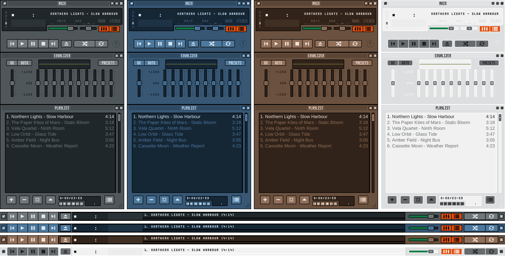

# Popamp D11

# ⚠️ This skin was generated automatically

## It needs a designer's edits to make it simpler

The pictures were written by a program, not drawn by a designer, so the
files are more complicated than the skin needs. Fork it and redraw it.

Flat dark grey, a slate display and orange lamps: the default theme of the d11amp player, drawn by Christian Ruesch, as vector sheets, with d11amp's mark replaced by Popamp's bolt.



A vector skin for [Popamp](https://github.com/popamp/popamp), skin format
version 1. It is only a port of an existing design; see
[Credits](#credits).

## Window or bar

The main window has a second view: a bar across the screen, at its top or
bottom edge, put together from the same pictures. Switch between the two
in the main menu's "Toolbar mode". This needs Popamp 1.0.0 or newer.

## Colours

The skin comes in four colours: Graphite (the theme as it is), Ocean,
Cocoa and Light. Pick one in the main menu's "Colours". This needs Popamp
1.0.0 or newer. Ocean and Cocoa give the theme's greys another hue and keep
the orange lamps: blue is the orange's opposite on the colour wheel, brown
is its neighbour. Light turns the greys' lightness round, so the body is
the grey of Windows 11's light taskbar and the bar at the screen's bottom
edge reads as its continuation.

## Media library

The media library window has the playlist's frame, its buttons and its
title bar, with its own "MEDIA LIBRARY" title in the theme's title font.
The theme draws no D or B; they are drawn after its P and R. This needs
Popamp 1.0.0 or newer.

## Install

With Popamp 0.6.0 or newer from [apt.popamp.app](https://apt.popamp.app):

```sh
sudo apt install popamp-skin-d11
```

Then pick it in the main menu's skin list. Or clone it into Popamp's
skins folder, where a copy of the same name wins over the package:

```sh
git clone https://github.com/popamp/skin-d11 ~/.local/share/popamp/skins/d11
```

Updating is `git pull` in that folder; Popamp reloads the skin.

## Rebuild

Everything in `sheets/`, `bar/`, `ml/` and `skin.toml` is generated by one script from
the original theme, `tools/d11amp-default.wsz`. It needs `python3-numpy`,
`python3-scipy` and `python3-pil`:

```sh
python3 -I -B tools/gen_d11_skin.py .
```

`--psz path/to/D11.psz` also packs a single file.

Change the script, not the generated files.

## How it is drawn

The theme is flat pixel art without gradients, so the script does not
trace pixels one by one:

- Every area of one colour is one whole shape, drawn without its holes;
  what lies in a hole is drawn over it. A window frame with a panel in it
  is two shapes, not a ring.
- An area that is a rectangle is a `<rect>`. Everything else of one colour
  on one level (letters, digits, icons, rules, rounded panels) is outlines
  in one `<path>`.
- Colours that differ by a step or two, left by the drawing program, are
  merged into one.
- The "D11 AMP" mark on the main window is replaced by the ring and bolt
  of Popamp's logo, in the mark's own colour.

The whole skin is about 500 shapes.

## Credits

This skin is a vector port of the default theme of
[d11amp](https://dettus.net/d11amp/), an oldskool MP3 player by Thomas
Dettbarn. The design is not ours:

> d11amp theme CC-0-1.0 by Christian Ruesch <cr@rt.fm>

Thank you, Christian, for giving it to the public domain.

## License

The theme and this port of it (`sheets/`, `skin.toml`, `preview.png`,
`tools/d11amp-default.wsz`) are under
[Creative Commons CC0 1.0 Universal](LICENSE-CC0), as the original is.
The script in `tools/` (`*.py`) is licensed under either of
[Apache License 2.0](LICENSE-APACHE) or [MIT license](LICENSE-MIT) at your
option.
